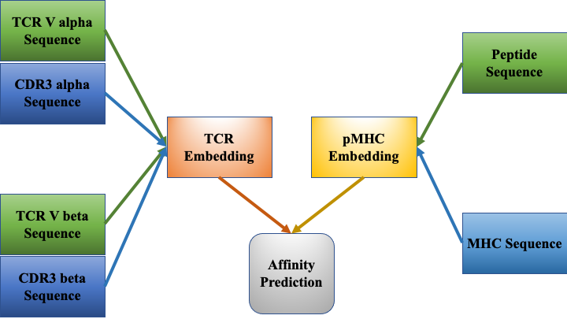
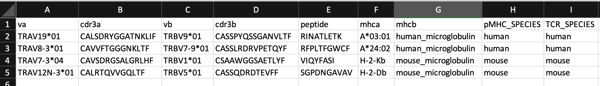
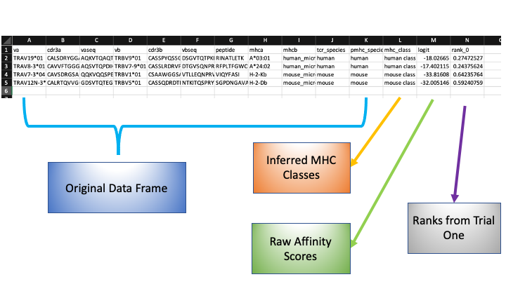

# pMTnet Omni: your one-stop TCR-pMHC affinity prediction algorithm :microscope:


| Package | Documentation | Code Coverage |
| --- | --- | --- |
| pMTnet Omni | | [](https://codecov.io/gh/Yuqiu-Yang/pMTnet_Omni) |
| pMTnet Omni Document | [](https://pmtnet-omni-document.readthedocs.io/en/latest/?badge=latest) | [](https://codecov.io/gh/Yuqiu-Yang/pMTnet_Omni_Document) |

<b>pMTnet Omni</b> is a deep learning algorithm for affinity prediction based on TCR Va, Vb, CDR3a, CDR3b sequences, peptide sequence, and MHC allele types. The predictions can be made for human and mouse alleles, and for both CD8 T cells/MHC class I and CD4 T cells/MHC class II.

Please refer to our paper for more details: [pMTnet Omni paper link here](www.google.com)

We host the supporting data as well the online tool on [DBAI](http://lce-test.biohpc.swmed.edu/pmtnet), where you can find all the members of the pMTnet 
family, including [pMTnet V1](https://github.com/tianshilu/pMTnet). 

We have also built a detailed [online documentation](https://pmtnet-omni-document.readthedocs.io/en/latest/) where we walk you through every single step for data preparation. It also includes a step-by-step instruction on input format. 

**_NOTE:_** We DO NOT have an online document for this repo. However, we do have HTML files for the documentation ready to go.

## Model Overview 


## Dependencies 
- numpy==1.22.4
- pandas==1.5.2
- matplotlib==3.6.2
- scikit-learn==1.0.2
- tqdm==4.64.1
- torch==1.13.1

## Enviroment Setup
```shell
conda env create -f pMTnet_Omni_env.yml
```

## Installation 
```shell
conda activate pMTnet_Omni
pip install pMTnet_Omni
```

## Quick Start Guide 
1. Go to [our website](http://lce-test.biohpc.swmed.edu/pmtnet) to download the supporting data to your local directory, say <i>./data</i>. 

<b>Caution: </b> the data file is around 30Gb. Make sure you have enough space on your hard drive. 

2. Prepare your dataset so that it looks somewhat like the following:


**_NOTE:_** We highly recommend using our supporting package [pMTnet_Omni_Document](https://github.com/Yuqiu-Yang/pMTnet_Omni_Document) to prepare your data. 


3. Say your dataset is under `./df.csv` and the extra MHC dictionary is saved at `./extra_mhc_dict.pickle`. In your terminal, run 
```shell
python -m pMTnet_Omni --data_dir ./data --user_data_path ./df.csv --extra_mhc_dict_path ./extra_mhc_dict.pickle --output_file_path ./df_results.csv
```

4. An example output would look like this:

 

