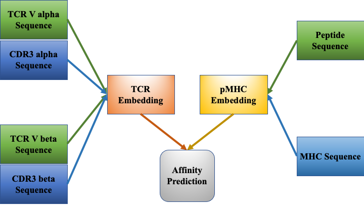

.. pMTnet_Omni documentation master file, created by
   sphinx-quickstart on Wed Dec 14 11:36:34 2022.
   You can adapt this file completely to your liking, but it should at least
   contain the root `toctree` directive.

**pMTnet Omni**: pan-MHC and cross-Species Prediction of T Cell Receptor-Antigen Binding
============================================================================================

.. warning:: 
   This document is only for internal reference. 

Profiling the binding of T cell receptors (TCRs) of T cells to antigenic peptides
presented by MHC proteins is one of the most important unsolved problems in modern immunology. 
We developed **pMTnet-omni**, an Artificial Intelligence (AI) system based on hybrid protein 
sequence and structure information, to predict the pairing of TCRs of :math:`{\alpha}` :math:`{\beta}` T cells with 
peptide-MHC complexes (pMHCs). **pMTnet-omni** is capable of handling peptides presented by both 
class I and II pMHCs, and capable of handling both human and mouse TCR-pMHC pairs, through information sharing
enabled this hybrid design. 

Here is a quick overview of the structure of the model:

For a more detailed exploration of our model, please refer to `our paper <https://doi.org/10.1101/2023.12.01.569599>`_:

.. code-block:: text

    @article {Han2023.12.01.569599,
      author = {Yi Han and Yuqiu Yang and Yanhua Tian and Farjana J. Fattah and Mitchell S. von Itzstein and Minying Zhang and Xiongbin Kang and Donghan M. Yang and Jialiang Liu and Yaming Xue and Chaoying Liang and Indu Raman and Chengsong Zhu and Olivia Xiao and Yifei Hu and Jonathan E. Dowell and Jade Homsi and Sawsan Rashdan and Shengjie Yang and Mary E. Gwin and David Hsiehchen and Yvonne Gloria-McCutchen and Ke Pan and Fangjiang Wu and Don Gibbons and Xinlei Wang and Cassian Yee and Junzhou Huang and Alexandre Reuben and Chao Cheng and Jianjun Zhang and David E. Gerber and Tao Wang},
      title = {pan-MHC and cross-Species Prediction of T Cell Receptor-Antigen Binding},
      elocation-id = {2023.12.01.569599},
      year = {2023},
      doi = {10.1101/2023.12.01.569599},
      publisher = {Cold Spring Harbor Laboratory},
      URL = {https://www.biorxiv.org/content/early/2023/12/12/2023.12.01.569599},
      eprint = {https://www.biorxiv.org/content/early/2023/12/12/2023.12.01.569599.full.pdf},
      journal = {bioRxiv}
   }

The online tool is hosted on `DBAI <https://dbai.biohpc.swmed.edu/pmtnet/>`_

Please follow `this link <https://365utsouthwestern-my.sharepoint.com/:u:/r/personal/yuqiu_yang_utsouthwestern_edu/Documents/pMTnet_Omni_datafile/data.tgz?csf=1&web=1&e=YdNTsn>`_ 
to download the supporting data. 

Dependencies
--------------

* python>=3.9, <3.11
* numpy==1.22.4
* pandas==1.5.2
* matplotlib==3.6.2
* scikit-learn==1.0.2
* tqdm==4.64.1
* torch==1.13.1
* pMTnet_Omni_Document

User Guide / Tutorial
=====================
.. toctree::
   :maxdepth: 1
   :caption: Get Started

   installation_guide
   quick_start
   online_tool_guide

.. toctree::
   :maxdepth: 3
   :caption: Input Format

   input_format/index

.. toctree::
   :maxdepth: 1
   :caption: Guided Tutorial

   tutorial/input_check
   tutorial/details

.. toctree::
   :maxdepth: 2
   :caption: API Reference

   api_reference/index

Indices and tables
==================

* :ref:`genindex`
* :ref:`modindex`
* :ref:`search`
