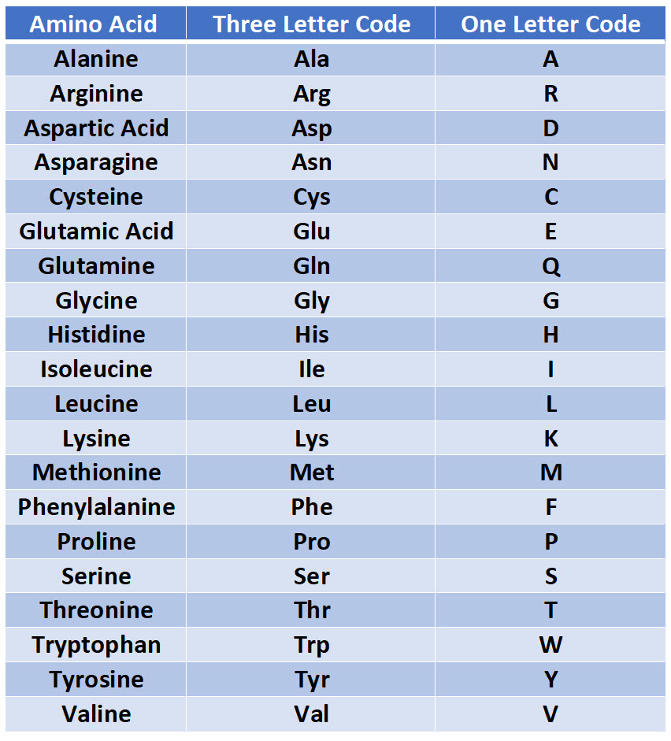

Amino Acids Sequences Format
=============================
Columns that **pMTnet Omni** expect to contain sequences of 
amino acids are 

.. list-table:: Columns of Amino Acids (AA) Sequences
   :align: center 
   :widths: 30 70 
   :header-rows: 1

   * - Name 
     - Meaning 
   * - vaseq 
     - The AA sequence the Alpha chain for the V segment
   * - vbseq
     - The AA sequence the Beta chain for the V segment
   * - cdr3a
     - The sequence of amino acids for the CDR3 region on the Alpha chain
   * - cdr3b
     - The sequence of amino acids for the CDR3 region on the Beta chain
   * - peptide 
     - The sequence of amino acids presented by the MHC
   * - mhcseq
     - The sequence(s) of amino acids of the corresponding MHC

Overall 
-----------
The **one-letter code** of the following 20 Amino Acids are 
accepted by **pMTnet Omni**. 

.. warning:: 
   If a letter in a provided sequence is not of the 20 amino acids
   (this includes cases such as actual letters\: ``X``, 
   white spaces\: :literal:`\ `, special characters\: ``_, +, /`` etc.),  
   it will first be replaced by ``_``. When converting to a matrix of 
   Atchley Factors, those ``_`` will be interpreted as ``0,0,0,0,0``.

vaseq vbseq 
---------------

cdr3a cdr3b 
---------------

peptide 
----------------

mhcseq 
----------------

