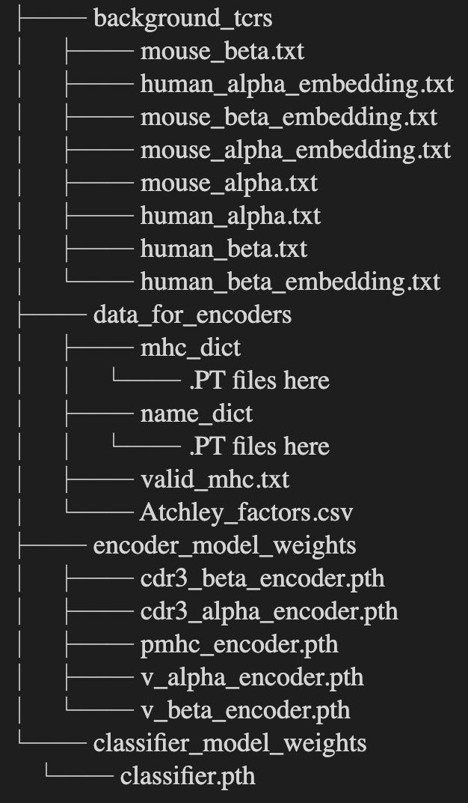

Installation Guide 
===============

Dependencies
-------------
The dependencies of pMTnet Omni is fairly standard for a deep learning-based application

* numpy==1.22.4
* pandas==1.5.2
* matplotlib==3.6.2
* scikit-learn==1.0.2
* tqdm==4.64.1
* torch==1.13.1

Environment Setup 
------------------
.. _installation guide:

Of course, you can create your own environment and install those dependencies manually. 
However, we have made this simple for you.

* Go to `our website <http://lce-test.biohpc.swmed.edu/pmtnet>`_ and download the environment file. Or, run 
  
  .. code:: bash 
    
    git clone https://github.com/Yuqiu-Yang/pMTnet_Omni.git
* Run 
  
  .. code:: bash 
    
    conda env create -f pMTnet_Omni_env.yml

This will create a conda environment *pMTnet_Omni*

Package Installation
--------------
Conda install
~~~~~~~~~~~~~~
.. code:: bash

   conda activate pMTnet_Omni
   conda install pMTnet_Omni

PyPI install
~~~~~~~~~~~~~
.. code:: bash

   conda activate pMTnet_Omni
   pip install pMTnet_Omni

Supporting Data Download 
-------------------------
pMTnet Omni requires some additional data to make accurate predictions. These files 
are too large (around 30Gb) to be stored on our `GitHub repo <https://github.com/Yuqiu-Yang/pMTnet_Omni>`_

These include:

* Model weights 
* A large number of background TCRs
* Output of the legendary ESM algorithm

Go to `our website <http://lce-test.biohpc.swmed.edu/pmtnet>`_ and download the data file 
if you have not already done so. 
The name of the directory can be changed to whatever you want (of course, it has to conform
with your system's naming convention) and the directory can be stored wherever you want. 

However, contents of the directory should **NOT** be altered for pMTnet Omni to execute properly.

The structure of the directory should look like this 

