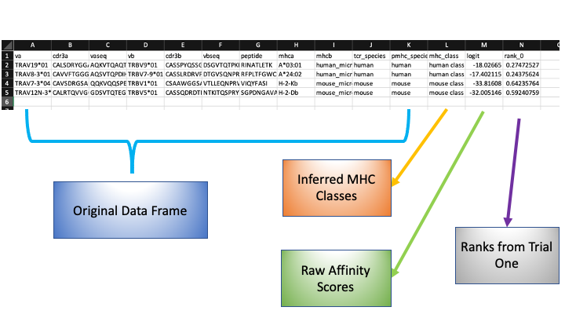

Quick Start Guide
==================
So I hear your week has been hectic. 
No worries. In this tutorial, we will walk through the basic usage of 
**pMTnet Omni** with minimum configuration. 
If you are truly swamped, we recommend `our online tool <https://dbai.biohpc.swmed.edu/pmtnet/>`_.

.. note:: 
    Before proceeding, make sure you have all the dependencies and the package 
    installed in your environment. 

    Please also make sure that you have downloaded the supporting data.  

    If not, please check out :doc:`installation_guide`. 

    We will assume that you already have the environment set up. 

.. note::
    For this tutorial, we will assume that the file path to the data directory is **"./data"**.
    If you are not sure if your directory is correctly configured, check out :doc:`installation_guide`.

.. note::
    We will use the validation data we published along with the package, whose location we 
    assume is at **./validation_data/example_input.csv**. It contained 
    around 5,000 TCR-pMHC pairs. The entire validation process could take several
    minutes. 
    
    If you would like to use your own data file, make sure your data file is structured 
    somewhat like the following:

    .. image:: ./images/sample_df.png
        :width: 600
        :align: center

    For a more detailed instruction on the data format, please check out :doc:`input_format/index`. 

CLI (Command Line Interface)
--------------------------------
By using CLI, you only need two lines of code. 

.. code:: bash 

    python -m pMTnet_Omni_Document --file_path ./validation_data/example_input.csv --output_folder_path ./validation_data
    python -m pMTnet_Omni --data_dir ./data --user_data ./validation_data/example_input_curated.csv --compute_percentile_rank --output_file_path ./validation_data/example_input_results.csv

Interactive Python 
-------------------
Data Curation
~~~~~~~~~~~~~~~~~~~~~~~~~~~~~~~~~
.. code-block:: python 

    # Import pMTnet Omni Document class 
    from pMTnet_Omni_Document.data_curation import read_file 
    # Perform data curation 
    df, mhc_seq_dict = read_file(file_path="./validation_data/example_input.csv")

Initialize the pMTnet_Omni_class 
~~~~~~~~~~~~~~~~~~~~~~~~~~~~~~~~~~~
.. code-block:: python 

    # Import pMTnet Omni class 
    from pMTnet_Omni.pMTnet_Omni_class import pMTnet_Omni_class

    # Initialize the class 
    pmtnet = pMTnet_Omni_class(data_dir="./data")

User Data Preprocessing 
~~~~~~~~~~~~~~~~~~~~~~~
.. code-block:: python 
    
    # Read user data 
    pmtnet.read_user_df(user_data=df)

Model Prediction 
~~~~~~~~~~~~~~~~
.. code-block:: python 

    # Final predcition 
    pmtnet.predict(output_file_path="./validation_data/df_results.csv")

If you check the `./validation_data` directory, you should be able to find 
a `.csv` file named `df_results_complete.csv`, whose content would look
somewhat like this 

